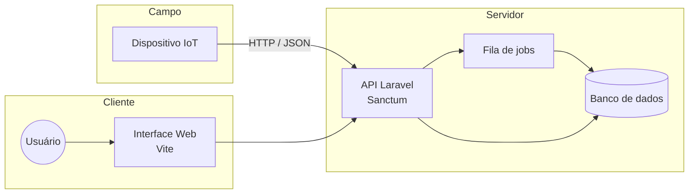

<div align="center">

<!-- Substitua por um logo:  -->

# GeoSync

**[Slogan em uma linha — ex.: Sincronização e monitoramento de geolocalização em tempo real.]**

[](https://www.php.net/)
[](https://laravel.com/)
[](https://vitejs.dev/)
[](#licença)

[](https://github.com/MuriloBreda/GeoSync/commits/main)
[](https://github.com/MuriloBreda/GeoSync/issues)
[](https://github.com/MuriloBreda/GeoSync/stargazers)

[Sobre](#sobre) ·
[Demonstração](#demonstração) ·
[Arquitetura](#arquitetura) ·
[Instalação](#instalação) ·
[API](#api) ·
[Módulo IoT](#módulo-iot) ·
[Deploy](#deploy-em-produção) ·
[Contribuindo](#contribuindo)

</div>

---

## Índice

- [Sobre](#sobre)
- [Funcionalidades](#funcionalidades)
- [Demonstração](#demonstração)
- [Arquitetura](#arquitetura)
- [Instalação](#instalação)
- [Configuração](#configuração)
- [Uso](#uso)
- [API](#api)
- [Módulo IoT](#módulo-iot)
- [Banco de dados](#banco-de-dados)
- [Testes e qualidade](#testes-e-qualidade)
- [Deploy em produção](#deploy-em-produção)
- [Segurança](#segurança)
- [Solução de problemas](#solução-de-problemas)
- [Roadmap](#roadmap)
- [Contribuindo](#contribuindo)
- [Licença](#licença)
- [Autor](#autor)

## Sobre

> **[Escreva de 2 a 4 linhas: qual problema o GeoSync resolve, para quem ele é voltado e qual o seu diferencial.]**

O GeoSync é uma aplicação web construída com **Laravel 12** que integra um módulo **IoT** a uma plataforma de gerenciamento, permitindo **[coletar, sincronizar e visualizar dados de localização]**.

### Por que o GeoSync?

| | |
| :-- | :-- |
| **[Benefício 1]** | **[Explique em uma linha]** |
| **[Benefício 2]** | **[Explique em uma linha]** |
| **[Benefício 3]** | **[Explique em uma linha]** |

## Funcionalidades

- **Autenticação segura** com Laravel Sanctum
- **Login social** com Laravel Socialite
- **Processamento assíncrono** com filas (queues) do Laravel
- **[Recepção de dados dos dispositivos IoT via API]**
- **[Visualização de localizações em mapa / dashboard]**
- **[Histórico e relatórios]**

## Demonstração

> Adicione capturas de tela ou um GIF na pasta `docs/assets/` e referencie aqui.

<!--
<p align="center">
  
</p>
-->

| Dashboard | Mapa | Dispositivos |
| :-: | :-: | :-: |
| *(imagem)* | *(imagem)* | *(imagem)* |

## Arquitetura

> Diagrama ilustrativo — ajuste conforme o fluxo real do projeto.



### Stack

| Camada | Tecnologia |
| :-- | :-- |
| Linguagem | PHP 8.2+ |
| Framework | Laravel 12 |
| Autenticação | Laravel Sanctum · Laravel Socialite |
| Frontend / build | Vite · npm |
| Banco de dados | **[MySQL / MariaDB]** |
| Observabilidade | Laravel Pail (logs em tempo real) |
| Qualidade | PHPUnit 11 · Laravel Pint |
| Ambiente local | Laravel Sail (Docker) — opcional |
| IoT | **[ESP32 / Arduino / Raspberry Pi]** |

### Estrutura de pastas

```text
GeoSync/
├── app/              # Models, controllers e regras de negócio
├── bootstrap/        # Inicialização do framework
├── config/           # Configurações da aplicação
├── database/         # Migrations, factories e seeders
├── iot/              # Código dos dispositivos IoT
├── public/           # Ponto de entrada web e assets públicos
├── resources/        # Views, CSS e JavaScript
├── routes/           # Rotas web e API
├── storage/          # Logs, cache e arquivos gerados
├── tests/            # Testes automatizados
├── geosync.sql       # Dump do esquema do banco de dados
└── schema_check.php  # Verificação de consistência do esquema
```

## Instalação

### Pré-requisitos

| Requisito | Versão |
| :-- | :-- |
| PHP | 8.2 ou superior |
| Composer | 2.x |
| Node.js + npm | LTS |
| Banco de dados | **[MySQL 8+ / MariaDB 10.6+]** |

### Início rápido

```bash
git clone https://github.com/MuriloBreda/GeoSync.git
cd GeoSync
composer run setup
```

O script `setup` instala as dependências PHP, cria o `.env`, gera a chave da aplicação, executa as migrations e compila o frontend.

<details>
<summary><b>Instalação manual (passo a passo)</b></summary>

```bash
composer install
cp .env.example .env
php artisan key:generate
npm install
npm run build
```

</details>

<details>
<summary><b>Usando Docker (Laravel Sail)</b></summary>

```bash
composer install
cp .env.example .env
./vendor/bin/sail up -d
./vendor/bin/sail artisan key:generate
./vendor/bin/sail artisan migrate
./vendor/bin/sail npm install && ./vendor/bin/sail npm run dev
```

</details>

## Configuração

### Banco de dados

Edite o `.env`:

```env
DB_CONNECTION=mysql
DB_HOST=127.0.0.1
DB_PORT=3306
DB_DATABASE=geosync
DB_USERNAME=seu_usuario
DB_PASSWORD=sua_senha
```

Crie as tabelas por **uma** das opções:

```bash
# Opção A — migrations
php artisan migrate

# Opção B — dump SQL
mysql -u seu_usuario -p geosync < geosync.sql
```

### Variáveis de ambiente

| Variável | Descrição | Obrigatória |
| :-- | :-- | :-: |
| `APP_KEY` | Chave da aplicação (gerada por `key:generate`) | ✅ |
| `APP_URL` | URL base da aplicação | ✅ |
| `DB_*` | Credenciais de conexão com o banco | ✅ |
| `QUEUE_CONNECTION` | Driver de filas (`database`, `redis`, `sync`) | ✅ |
| `GOOGLE_CLIENT_ID` | Client ID do provedor de login social | **[ ]** |
| `GOOGLE_CLIENT_SECRET` | Client Secret do provedor de login social | **[ ]** |
| `GOOGLE_REDIRECT_URI` | URL de callback do login social | **[ ]** |

> Consulte o `.env.example` para a lista completa.

## Uso

Para subir servidor, fila, logs e Vite em um único comando:

```bash
composer run dev
```

| Serviço | Comando equivalente | Endereço |
| :-- | :-- | :-- |
| Servidor | `php artisan serve` | http://localhost:8000 |
| Fila | `php artisan queue:listen` | — |
| Logs | `php artisan pail` | — |
| Frontend | `npm run dev` | http://localhost:5173 |

## API

> **[Documente aqui os endpoints reais do projeto.]**

A autenticação é feita via **token Bearer** (Laravel Sanctum):

```http
Authorization: Bearer <seu_token>
Accept: application/json
```

| Método | Endpoint | Descrição | Auth |
| :-: | :-- | :-- | :-: |
| `POST` | `/api/login` | **[Autentica e retorna o token]** | ❌ |
| `POST` | `/api/locations` | **[Registra uma localização]** | ✅ |
| `GET` | `/api/locations` | **[Lista localizações]** | ✅ |
| `GET` | `/api/devices` | **[Lista dispositivos]** | ✅ |

<details>
<summary><b>Exemplo: registrar uma localização</b></summary>

**Requisição**

```http
POST /api/locations
Content-Type: application/json
Authorization: Bearer <seu_token>

{
  "device_id": "esp32-001",
  "latitude": -23.5505,
  "longitude": -46.6333,
  "timestamp": "2026-10-27T12:00:00Z"
}
```

**Resposta `201 Created`**

```json
{
  "id": 1,
  "device_id": "esp32-001",
  "latitude": -23.5505,
  "longitude": -46.6333,
  "timestamp": "2026-10-27T12:00:00Z"
}
```

</details>

## Módulo IoT

> **[Complete esta seção com os detalhes do hardware e da comunicação.]**

| Item | Detalhe |
| :-- | :-- |
| Hardware | **[modelo do dispositivo e sensor GPS]** |
| Firmware | **[linguagem / framework — ex.: C++ com Arduino IDE]** |
| Conectividade | **[Wi-Fi / GSM / LoRa]** |
| Protocolo | HTTP com payload JSON |
| Intervalo de envio | **[ex.: a cada 10 segundos]** |

**Configuração do dispositivo:** defina no código a rede Wi-Fi, a URL da API e o token de autenticação.

**Ligação dos componentes:**

| Componente | Pino |
| :-- | :-- |
| **[GPS TX]** | **[RX do microcontrolador]** |
| **[GPS RX]** | **[TX do microcontrolador]** |

## Banco de dados

O esquema completo está em [`geosync.sql`](geosync.sql). Para conferir se o banco está consistente com o esperado:

```bash
php schema_check.php
```

> **[Opcional: adicione um diagrama ER com as principais tabelas.]**

## Testes e qualidade

```bash
# Testes automatizados
composer run test

# Padronização de código (Laravel Pint)
./vendor/bin/pint

# Verificar sem alterar arquivos
./vendor/bin/pint --test
```

## Deploy em produção

Checklist mínimo:

```bash
git pull origin main
composer install --no-dev --optimize-autoloader
npm ci && npm run build
php artisan migrate --force
php artisan config:cache
php artisan route:cache
php artisan view:cache
php artisan queue:restart
```

Antes de publicar, confirme no `.env`:

- [ ] `APP_ENV=production`
- [ ] `APP_DEBUG=false`
- [ ] `APP_URL` com o domínio correto e HTTPS
- [ ] Banco de dados com usuário de privilégios mínimos
- [ ] Worker de fila rodando sob um supervisor (ex.: Supervisor, systemd)

## Segurança

- Nunca versione o arquivo `.env` ou credenciais de produção.
- Use sempre HTTPS em produção, principalmente para a comunicação com os dispositivos IoT.
- Revogue tokens de dispositivos perdidos ou comprometidos.
- Para reportar uma vulnerabilidade, **não abra uma issue pública**: entre em contato diretamente com o autor via GitHub ou **[e-mail de contato]**.

## Solução de problemas

| Problema | Solução |
| :-- | :-- |
| `No application encryption key has been specified` | Execute `php artisan key:generate` |
| Erro de conexão com o banco | Confira as variáveis `DB_*` e se o serviço do banco está ativo |
| Assets não carregam | Execute `npm install && npm run build` (ou `composer run dev`) |
| Jobs não são processados | Verifique se `php artisan queue:listen` está rodando |
| Mudanças no `.env` não surtem efeito | Execute `php artisan config:clear` |
| Erro `419` ou `401` na API | Confira o token Bearer e o header `Accept: application/json` |

## Roadmap

- [x] Estrutura base com Laravel 12
- [x] Autenticação com Sanctum e Socialite
- [ ] **[Funcionalidade planejada 1]**
- [ ] **[Funcionalidade planejada 2]**
- [ ] **[Funcionalidade planejada 3]**

Sugestões são bem-vindas nas [issues](https://github.com/MuriloBreda/GeoSync/issues).

## Contribuindo

Contribuições são muito bem-vindas!

1. Faça um fork do projeto
2. Crie sua branch: `git checkout -b feat/minha-feature`
3. Rode os testes e o Pint antes de commitar
4. Commit suas mudanças: `git commit -m "feat: adiciona minha feature"`
5. Envie para a branch: `git push origin feat/minha-feature`
6. Abra um Pull Request descrevendo o que mudou e por quê

Este projeto adota o padrão [Conventional Commits](https://www.conventionalcommits.org/pt-br/).

| Prefixo | Uso |
| :-- | :-- |
| `feat` | Nova funcionalidade |
| `fix` | Correção de bug |
| `docs` | Alterações na documentação |
| `refactor` | Refatoração sem mudança de comportamento |
| `test` | Criação ou ajuste de testes |
| `chore` | Tarefas de manutenção |

## Licença

Distribuído sob a licença **MIT**. Veja o arquivo `LICENSE` para mais informações.

## Autor

**Murilo Breda**

[](https://github.com/MuriloBreda)

---

<div align="center">

Se este projeto foi útil, considere deixar uma ⭐

</div>
