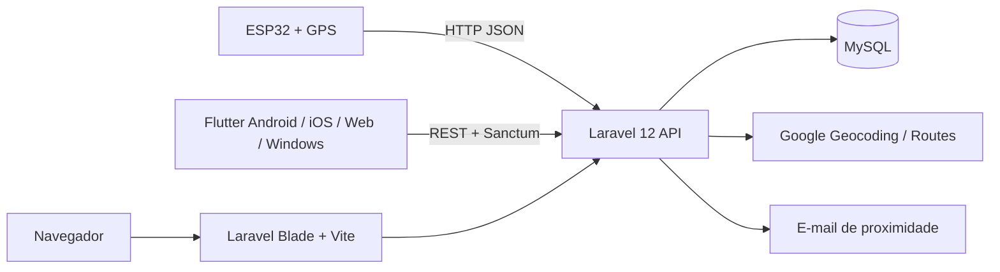

# GeoSync

Plataforma de logística que conecta um painel web, uma API Laravel, um aplicativo Flutter e um dispositivo GPS baseado em ESP32. O sistema acompanha remessas, registra posições do veículo e mantém clientes e motoristas informados sobre o andamento das entregas.

## Componentes

| Componente | Diretório | Função |
| --- | --- | --- |
| Backend e painel web | [`GeoSync/`](GeoSync/) | Aplicação Laravel 12, API REST, regras de negócio e interface web para clientes, motoristas e administradores. |
| Firmware GPS | [`GeoSync/iot/`](GeoSync/iot/) | Firmware Arduino para ESP32 com GPS UART e envio periódico de coordenadas por HTTP/JSON. |
| Aplicativo móvel | [`App/geo_sync_mobile/`](App/geo_sync_mobile/) | Aplicativo Flutter para operações de cliente e motorista, mapas, remessas e sincronização offline. |
| Esquema SQL | [`Banco de Dados/geosync.sql`](Banco%20de%20Dados/geosync.sql) | Exportação do banco de dados do projeto. |
| Material do TCC | [`Apresentação/`](Apresentação/) | Apresentação e vídeo do trabalho. |

## Funcionalidades

- Cadastro, login e sessão por tipo de usuário (cliente, motorista e administrador), com API autenticada por tokens Laravel Sanctum e login Google na web.
- Cadastro e gerenciamento de remessas, atribuição/aceite por motoristas, atualização de status e painéis separados por perfil.
- Rastreamento por GPS do ESP32, histórico e última localização da remessa, cálculo de distância até o destino e aviso por e-mail quando o veículo chega a até 100 metros.
- Geocodificação de destinos e estimativa de distância/tempo por ruas usando Google Routes API, quando a chave está configurada.
- Gestão de alertas, pagamentos, avaliações, contatos, perfil e operações administrativas; recursos web incluem também chat e análise antifraude.
- Aplicativo Flutter com áreas de cliente e motorista, mapas, QR Code, comprovante e ocorrências de entrega, alertas, perfil, documentos e dados do veículo.
- Cache e fila local de ações no aplicativo, sincronização incremental, tratamento de conflitos e exportação de localizações/remessas em CSV e GeoJSON.

## Arquitetura



O firmware envia a localização a cada 5 segundos ao endpoint público `POST /api/localizacao`, identificada pelo `remessa_id`. O backend valida e armazena o ponto, associa-o à remessa e verifica a proximidade do destino. A API e o aplicativo trocam dados em JSON; as rotas protegidas usam `Authorization: Bearer <token>`.

## Início rápido

Requisitos do backend: PHP 8.2+, Composer 2, Node.js/npm e MySQL compatível. Requisitos do aplicativo: Flutter SDK compatível com Dart `^3.10.8` e ferramentas da plataforma alvo.

```powershell
cd GeoSync
composer install
Copy-Item .env.example .env
php artisan key:generate
```

Configure o banco e demais integrações no `.env`, depois execute:

```powershell
php artisan migrate
npm install
npm run build
composer run dev
```

O comando `composer run dev` inicia servidor Laravel, worker de fila, visualização de logs e Vite. O painel fica em `http://localhost:8000`. Para configurar e iniciar o aplicativo, siga [`App/geo_sync_mobile/README.md`](App/geo_sync_mobile/README.md); para ligar o ESP32, consulte [`GeoSync/iot/README.md`](GeoSync/iot/README.md).

## API

As rotas estão definidas em [`GeoSync/routes/api.php`](GeoSync/routes/api.php). Entre as operações disponíveis estão autenticação (`auth/register`, `auth/login`, `auth/me`, `auth/logout`), perfil, remessas, alertas, pagamentos, avaliações, localização GPS e estimativa de rota. A tabela completa, métodos e proteção estão no [guia do backend](GeoSync/README.md#api-rest).

## Configurações externas

- `GOOGLE_MAPS_API_KEY`: geocodificação de destino (conforme configuração do serviço).
- `GOOGLE_ROUTES_API_KEY`: estimativa de rota viária; mantenha somente no servidor.
- `MAIL_*`: envio do aviso de proximidade. O padrão `MAIL_MAILER=log` grava as mensagens nos logs e não envia e-mail.
- URL e credenciais de rede do ESP32 são configuradas na cópia local do firmware; não grave credenciais reais no repositório.

## Verificações

No backend: `cd GeoSync; composer run test`. No app: `cd App/geo_sync_mobile; flutter analyze` e `flutter test`. O repositório contém testes automatizados, mas as instruções acima não executam builds nem publicam artefatos.

## Documentação por componente

- [Backend, painel web, API, banco e instalação](GeoSync/README.md)
- [Firmware e montagem IoT](GeoSync/iot/README.md)
- [Aplicativo Flutter, configuração, recursos e testes](App/geo_sync_mobile/README.md)

## Créditos

Projeto de Trabalho de Conclusão de Curso desenvolvido por [Murilo Breda](https://github.com/MuriloBreda) e [Maria Clara Luz](https://github.com/mariaclaraluz0). Consulte os diretórios de apresentação para o material acadêmico.
